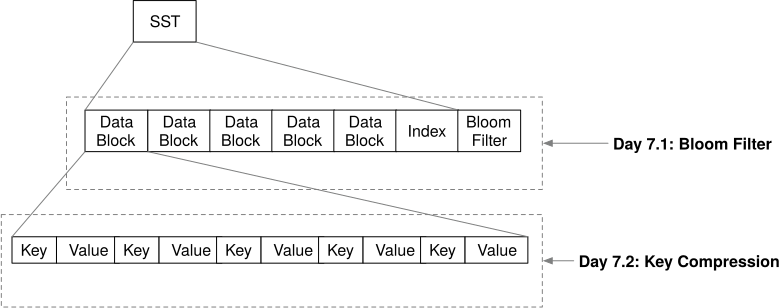

# Week 1

## Day 1
One mutable memtable, followed by zero or more immutable memtables awaiting flush.

**Invariants:**

- The engine has exaclty one current mutable memtable.
- The `imm_memtables` are ordered from newest to oldest.
- The first version of the key found while probing from newest to oldest determines the results.
- An empty value is a tombstone, that determines that the key is absent; the search must not continue to older values. 
  In mini-lsm, a key associated with an empty value represents a deletion.
- Structural changes such as replacing the mutable memtable is serialized, even though reads and writes to the mutable memtable are concurrent.

We are not using `upgradable_read` because all put operations will require a read lock but upgradable read can only be granted to one thread
at a time, so in this particular use case, because we want to allow all threads to perform put operations without synchorinizing them via 
locks, upgradable read would be the wrong choice, as it'll work like a write lock rather than a read lock.

## Day 2
The output is sorted, and each user key appears at most once with the value from the newest input containing that key. Tombstones participate
in the precedence before `LsmIterator` hides them.

**Invariants:**

- `MemTableIterator` exposes one sorted memtable.
- `MergeIterator` combines sources of the same type, removes duplicate versions, and gives lower-indexed—that is, newer—sources precedence.
- `LsmIterator` removes tombstones from the user-visible stream.
- `FusedIterator` makes invalid and errored states safe for callers.

Uses a cursor based API, common in databases and inspired by RocksDB's iterator.

## Day 3
Blocks: A compact sequence of sorted entries plus an index of their starting offsets.

- Encoding and Decoding are inverses for every valid block.
- Entry offsets are ordered and refer to valid positions in the data section.
- The footer contains exactly one offset per entry and the encoded entry count.
- Except when the first entry alone exceed the target, adding an entry must not make the block larger than `target_size`.
- Seeking, positions the iterator at the first key greater than or equal to the target, or makes it invalid if no such key exists.

An SST consists of multiple blocks, and when enough immutable memtables accumumlate, the engine flushes the oldest one to an SST.

The block encoding format:
```
----------------------------------------------------------------------------------------------------
|             Data Section             |              Offset Section             |      Extra      |
----------------------------------------------------------------------------------------------------
| Entry #1 | Entry #2 | ... | Entry #N | Offset #1 | Offset #2 | ... | Offset #N | num_of_elements |
----------------------------------------------------------------------------------------------------
```

Each `Entry` is a key value pair:
```
-----------------------------------------------------------------------
|                           Entry #1                            | ... |
-----------------------------------------------------------------------
| key_len (2B) | key (keylen) | value_len (2B) | value (varlen) | ... |
-----------------------------------------------------------------------
```

## Day 4
An SST composes many blocks into an immutable file and adds enough metadata to locate which block the requested key belongs to.

**Invariants:**

- Blocks and their metadata appear in the same key order.
- Each `BlockMeta` records block's offset and their actual first and last key.
- An iterator directly retains only the block it currently needs and will move to the next one if a seek lands beyond the current
  block. The cache may retain other blocks independently.
- A lower bound key never skips a key greater than or equal to the target.
- The block cache identifies a block both by its SST_ID's and block index. Block from different SSDs must never collide.

**Task1:**

An SST consists of data blocks and index blocks, they are loaded lazily when being read. We don't implement the index blocks and
assume that for our usecase the entire `BlockMeta` fits within the main memory.

The `BlockMeta` must contain the information for every block and concerning its `offset`, `first_key`, and `last_key`.

The SST encoding has the following layout.
```
-------------------------------------------------------------------------------------------
|         Block Section         |          Meta Section         |          Extra          |
-------------------------------------------------------------------------------------------
| data block | ... | data block |            metadata           | meta block offset (u32) |
-------------------------------------------------------------------------------------------
```

## Day 5


**Read Path Invariants**

- Mutable and Immutable memtables take precendence over SSTables, and newer sources take precedence over older sources within each group.
- A tombstone in a newer source hides every other older value for that key.
- `scan` returns sorted, unique, live values within the exact requested bounds.
- A seek may land on the next greater key, so `get` returns a value only after checking for exact key equality.
- Creating and Seeking SST iterators may perform I/O and therefore happens after releasing the state lock, using a consistent cloned
  snapshot

## Day 6


**Write Path Invariants**

- Only the oldest immutable memtable is selected for the next flush.
- `state_lock` serializes the flush with other structural changes.
- Building and writing the SST occurs outside the read-write lock.
- Installing the SST removes exactly the memtable that was flushed, inserts the `SsTable` into `ss_tables`, and inserts its ID at the 
  front - the newest side - of the `l0_ss_tables` in one snapshot update.
- SST optimization may only exclude a file when its key range cannot contribute to the user request. An optimization should not change
  query results.

## Day 7



**Optimization Invariants**

- A Bloom Filter negative result must be deterministic: An SST skipped after a negative probe cannot contain the key at all, but a positive
  result may be false and therefore still require a lookup.
- The builder and reader hash exactly the same key bytes with the same function.
- Prefix encoding and then decoding reconstructs every original key exactly.
- Each compressed key is defined relative to the first key in its block, so it can be decoded without decoding every preceeding entry.
- These optimizations may change I/O counts and encoded sized, but never the key-value pairs returned from `get` or `scan`.
