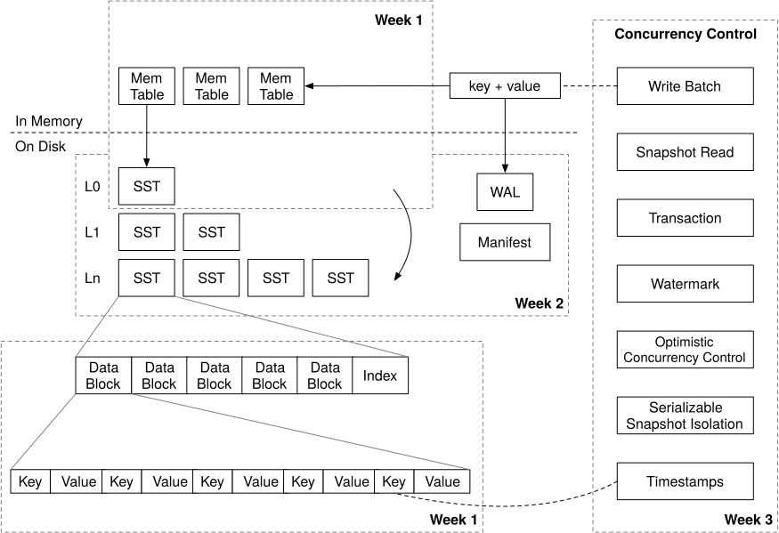

# bellpepper

An LSM-tree key-value storage engine written in Rust, modeled after RocksDB and Pebble (built on top of the [mini-lsm](https://github.com/skyzh/mini-lsm) specification).

After previously building a page-oriented B+Tree storage engine, I built `bellpepper` to understand the storage engine of LSM Tree based databases: 
how in-memory skiplists works and transitions into an immutable on-disk SSTables, how iterators compose across overlapping and non-overlapping runs, 
and how RocksDB's dynamic leveled compaction actually bounds write and space amplification.

---

## Architecture & What's Inside



### 1. MemTable & Manual Self-Referential Iteration
- Active writes go into a lock-free `crossbeam_skiplist::SkipMap<Bytes, Bytes>` paired with an append-only Write-Ahead Log (`WAL`).
- Once the active MemTable crosses the target size limit (`target_sst_size`), it is frozen into an immutable list (`imm_memtables`) and flushed to `L0` by a 
background flush thread.
- `MemTableIterator` needs to hold both an `Arc<SkipMap>` and a `SkipMapRangeIter<'_>` borrowing from it. Because `SkipMap`  lives at a stable heap address 
behind `Arc`, moving the `Arc` pointer itself does not invalidate the iterator's internal heap pointers. I implemented this  manually by erasing the 
iterator's lifetime to `'static` via `std::mem::transmute` and placing `iter` *before* `_map` in the struct definition since rust drop order guarantees 
the iterator drops first while the `Arc` allocation is still alive.

### 2. On-Disk Format: Blocks, SSTables, and Bloom Filters
- **Data Blocks (4 KiB):** Keys are prefix-compressed against the block's first key (`overlap_len | rest_key_len | rest_key | val_len | val`). Entry offsets 
and `num_of_elements` sit in the block **trailer** rather than the header—since keys are variable-length, we don't know the entry count while streaming keys 
in, and putting the offset table at the end avoids `memmove`-ing the data buffer on finalize.
- **Bloom Filters:** Built at the end of SSTable construction from collected 32-bit `farmhash` fingerprints. Uses Kirsch–Mitzenmacher double hashing 
(`delta = h.rotate_left(15)`), rotating the high 15 bits down into the low bits so `h = h.wrapping_add(delta)` injects the upper bits of the hash into the 
`% nbits` calculation on each of the $k$ probes without running $k$ separate hash functions.
- **SSTable Layout:**
  ```text
  [ Data Block 0 | CRC32 ] ... [ Data Block N | CRC32 ]
  [ BlockMeta Index | CRC32 ] [ meta_offset (u32) ]
  [ Bloom Filter | k (u8) | CRC32 ] [ bloom_offset (u32) ]
  ```
- Reads use `FileExt::read_exact_at` (`pread`) so concurrent readers never contend on a shared file-offset cursor, with decoded blocks cached in a concurrent 
`moka` cache.

### 3. Composable Iterator Stack
Point lookups (`get`) and range scans (`scan`) merge views across memory and disk without holding global locks (using Copy-on-Write `Arc<LsmStorageState>` snapshots):
- **`MergeIterator<I>`:** Merges overlapping runs (MemTables, `L0` SSTs) using a `BinaryHeap`. The winning iterator is kept outside the heap in `self.current` 
so advancing keys can compare directly against `iters.peek_mut()` and use `std::mem::swap` 
(a single $O(\log K)$ sift-down on `PeekMut::drop` instead of `pop` + `push`). Each iterator in the heap is boxed (`Box<I>`) so heap sifts swap 16-byte 
`(usize, Box<I>)` pairs in registers rather than copying ~200-byte iterator structs.
- **`SstConcatIterator`:** Lazily steps through non-overlapping sorted SSTs in `L1..L_max`, opening the next SST only when the current one is exhausted.
- **`TwoMergeIterator<A, B>`:** Zero-allocation static merge of two heterogeneous iterators, preferring `A` on key ties.
- **`LsmIterator` & `FusedIterator`:** Enforces upper range bounds, strips empty-value tombstones, and wraps the public iterator in a fused safety boundary so calling 
`next()` after exhaustion or I/O error is a safe no-op instead of panicking internal `.unwrap()`s.

### 4. RocksDB-Style Leveled Compaction (Dynamic Level Sizing)
`bellpepper` focuses on RocksDB's style **Leveled Compaction with Dynamic Level Sizes**:
- Target level budgets are computed **bottom-up** starting from `L_max` (`real_size.max(base_level_size)`), dividing by `level_size_multiplier` at each level upward 
until the level below drops at or below `base_level_size_bytes`.
- The highest level with a non-zero target budget becomes `base_level`. When the database is small, upper levels stay at a `0`-byte budget and `L0` compacts directly 
into `base_level`, avoiding pointless cascading disk writes through tiny intermediate levels.
- Once `L0` reaches `level0_file_num_compaction_trigger`, `L0 -> base_level` takes top priority. Otherwise, levels with `real_size / target_size > 1.0` are ranked by 
priority ratio, and the oldest SST (smallest SST ID) in the most over-budget level is compacted into `level + 1` along with all overlapping SSTs in `level + 1`.
- Tombstones are preserved in intermediate levels and only garbage-collected when `lower_level == max_levels`.

### 5. Crash Recovery & Durability (`MANIFEST` + `WAL`)
- **`WAL`:** Every `put`/`delete` is framed as `[key_len (u16) | key | val_len (u16) | val | crc32 (u32)]`. When a MemTable freezes, its `BufWriter` is flushed and 
fsynced; when its SSTable flushes to disk, the old `.wal` file is unlinked.
- **`MANIFEST`:** Logs `NewMemtable`, `Flush`, and `Compaction` records as checksummed JSON frames. On startup, `bellpepper` replays the manifest in memory to reconstruct 
the exact set of live SSTs and un-flushed WALs, opens the surviving `.sst` files, sorts each level's SSTs by `first_key()`, and replays the remaining `.wal` files into `imm_memtables`.
- **`state_lock` vs `state` Lock Ordering:** Heavy disk I/O (building SSTs during flushes and compactions) always runs *outside* locks. State transitions serialize on 
`state_lock: Mutex<()>` and swap the `Arc<LsmStorageState>` pointer under a brief `RwLock::write()`, followed by `sync_dir()` (`fsync` on the directory FD) so newly 
created/renamed file entries are durable.

---

## Running Tests

```bash
# Run the full test suite (using cargo-nextest or cargo test)
cargo nextest run
# or
cargo test
```

## API
Will document later as there is a lot of cleanup work needed even though the project is complete.

## To Change
- Write your own cli after looking up some examples of neat ones.
- Removal of unwraps with better error handling.

## Future Additions
- We are storing the meta block for all the SSTs in memory. Look into building a persistent index instead to get the meta blocks from disk to support sizes larger than ram.
