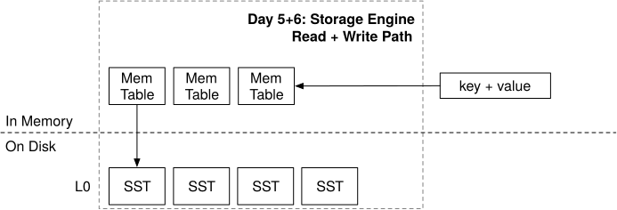

# Week 1

## Day 1
One mutable memtable, followed by zero or more immutable memtables awaiting flush.

**Invariants:**

- The engine has exaclty one current mutable memtable.
- The `imm_memtables` are ordered from newest to oldest.
- The first version of the key found while probing from newest to oldest determines the results.
- An empty value is a tombstone, that determines that the key is absent; the search must not continue to older values. 
  In mini-lsm, a key associated with an empty value represents a deletion.
- Structural changes such as replacing the mutable memtable is serialized, even though reads and writes to the mutable memtable are concurrent.

We are not using `upgradable_read` because all put operations will require a read lock but upgradable read can only be granted to one thread
at a time, so in this particular use case, because we want to allow all threads to perform put operations without synchorinizing them via 
locks, upgradable read would be the wrong choice, as it'll work like a write lock rather than a read lock.

## Day 2
The output is sorted, and each user key appears at most once with the value from the newest input containing that key. Tombstones participate
in the precedence before `LsmIterator` hides them.

**Invariants:**

- `MemTableIterator` exposes one sorted memtable.
- `MergeIterator` combines sources of the same type, removes duplicate versions, and gives lower-indexed—that is, newer—sources precedence.
- `LsmIterator` removes tombstones from the user-visible stream.
- `FusedIterator` makes invalid and errored states safe for callers.

Uses a cursor based API, common in databases and inspired by RocksDB's iterator.

## Day 3
Blocks: A compact sequence of sorted entries plus an index of their starting offsets.

- Encoding and Decoding are inverses for every valid block.
- Entry offsets are ordered and refer to valid positions in the data section.
- The footer contains exactly one offset per entry and the encoded entry count.
- Except when the first entry alone exceed the target, adding an entry must not make the block larger than `target_size`.
- Seeking, positions the iterator at the first key greater than or equal to the target, or makes it invalid if no such key exists.

An SST consists of multiple blocks, and when enough immutable memtables accumumlate, the engine flushes the oldest one to an SST.

The block encoding format:
```
----------------------------------------------------------------------------------------------------
|             Data Section             |              Offset Section             |      Extra      |
----------------------------------------------------------------------------------------------------
| Entry #1 | Entry #2 | ... | Entry #N | Offset #1 | Offset #2 | ... | Offset #N | num_of_elements |
----------------------------------------------------------------------------------------------------
```

Each `Entry` is a key value pair:
```
-----------------------------------------------------------------------
|                           Entry #1                            | ... |
-----------------------------------------------------------------------
| key_len (2B) | key (keylen) | value_len (2B) | value (varlen) | ... |
-----------------------------------------------------------------------
```

## Day 4
An SST composes many blocks into an immutable file and adds enough metadata to locate which block the requested key belongs to.

**Invariants:**

- Blocks and their metadata appear in the same key order.
- Each `BlockMeta` records block's offset and their actual first and last key.
- An iterator directly retains only the block it currently needs and will move to the next one if a seek lands beyond the current
  block. The cache may retain other blocks independently.
- A lower bound key never skips a key greater than or equal to the target.
- The block cache identifies a block both by its SST_ID's and block index. Block from different SSDs must never collide.

**Task1:**

An SST consists of data blocks and index blocks, they are loaded lazily when being read. We don't implement the index blocks and
assume that for our usecase the entire `BlockMeta` fits within the main memory.

The `BlockMeta` must contain the information for every block and concerning its `offset`, `first_key`, and `last_key`.

The SST encoding has the following layout.
```
-------------------------------------------------------------------------------------------
|         Block Section         |          Meta Section         |          Extra          |
-------------------------------------------------------------------------------------------
| data block | ... | data block |            metadata           | meta block offset (u32) |
-------------------------------------------------------------------------------------------
```

## Day 5



**Read Path Invariants**

- Mutable and Immutable memtables take precendence over SSTables, and newer sources take precedence over older sources within each group.
- A tombstone in a newer source hides every other older value for that key.
- `scan` returns sorted, unique, live values within the exact requested bounds.
- A seek may land on the next greater key, so `get` returns a value only after checking for exact key equality.
- Creating and Seeking SST iterators may perform I/O and therefore happens after releasing the state lock, using a consistent cloned
  snapshot

### The `for<'a>` syntax (Gemini Written)

**1. The `'static` Bound**

```rust
A: 'static + StorageIterator
```
**What it means:** The type `A` (and `B`) cannot contain any short-lived references (like `&'a [u8]`). They must either own all 
their data or use smart pointers like `Arc`.

**Why we need it here:** You are storing `a: A` and `b: B` directly inside the `TwoMergeIterator` struct. If `A` or `B` contained 
temporary references to local variables, `TwoMergeIterator` would become infected with those lifetimes. By enforcing `'static`, we 
tell the compiler: *"These iterators are self-sufficient. I can move this struct around without worrying about dangling pointers."*

**2. The `for<'a>` Bound (Higher-Rank Trait Bound)**

```rust
for<'a> StorageIterator<...>
```
**What it means:** "For any possible lifetime `'a` that the user requests."

**Why we need it here:** This solves the **Streaming Iterator Problem**. 

Look at the `key` method: `fn key(&self) -> Self::KeyType<'_>;`. 

Every single time you call `a.key()`, you borrow `a`. That borrow creates a brand new, microscopic lifetime (e.g., `'1`). When you call 
`a.key()` again on the next loop iteration, it creates a *different* microscopic lifetime (e.g., `'2`). 

If we didn't use `for<'a>`, the compiler would try to lock `B`'s trait implementation to a single, rigid lifetime. The compiler would 
panic on the second loop iteration, saying *"You gave me lifetime `'2`, but I am locked to `'1`!"*

By using `for<'a>`, we tell the compiler: 
*"I don't care how many times I call `.key()` or how short those borrows are. `B` must be able to satisfy the trait for **all** of them."*

**3. The Equality Constraint**

```rust
KeyType<'a> = A::KeyType<'a>
```
**What it means:** The key type of `B` must perfectly match the key type of `A`.

**Why we need it here:** `TwoMergeIterator` is merging `A` and `B`. To do this, it has to compare their keys (`a.key() < b.key()`). If `A` 
yields a `KeySlice` and `B` yields a `String`, you can't compare them directly, nor can `TwoMergeIterator` figure out what type it is 
supposed to return from its own `key()` method! This bound forces `B` to yield the exact same type as `A`.

### Summary Translation
If you read the whole block in plain English, it says:
> *"I am building a `TwoMergeIterator` that holds two self-sufficient iterators, `A` and `B`. Because I am merging them, `B` must be able to 
generate the exact same key type as `A`, and it must be able to do so repeatedly for any microscopic lifetime I ask for."*

***

Does that bring the mental model back into focus? 

If so, let's jump back into the logic for `TwoMergeIterator`. 

`A` holds the newer data. `B` holds the older data. 

**Question:** In the `create` method, if `a.key() == b.key()`, we have a duplicate. We want to keep `a` and throw away the key in `b`. What 
single method call must you execute on `b` to skip that duplicate key before you return the struct to the user?
